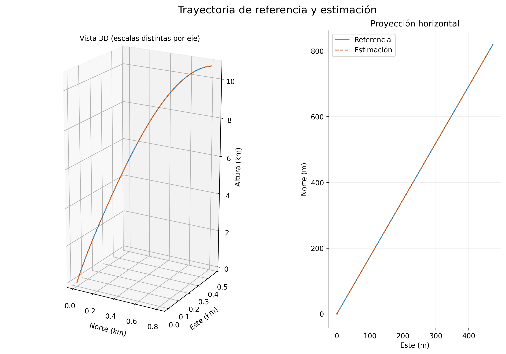
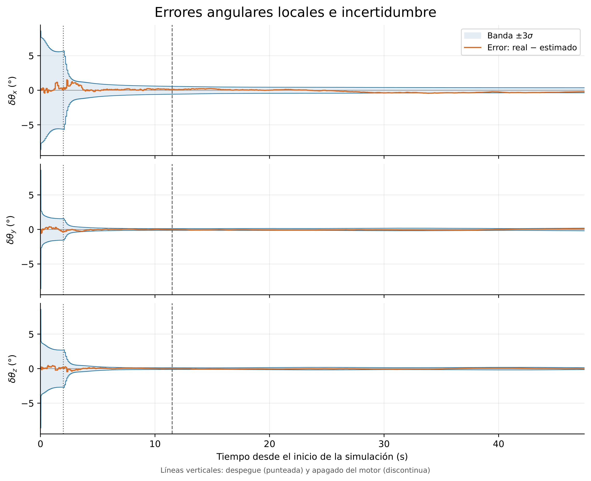

# Aerospace Vehicle State Estimation — Error-State Kalman Filter

**C11 · Sensor fusion · Inertial navigation · Numerical simulation**

A personal project implementing and evaluating an Error-State Kalman Filter (ESKF) for rocket state estimation. The estimator combines IMU prediction with GNSS, barometric and magnetometer corrections to estimate position, velocity, attitude and inertial sensor biases.

The repository includes the estimator, an integration check, two synthetic flight scenarios, recorded CSV results, plots and a detailed technical report in Spanish. Evaluation currently covers desktop simulation.



## Estimator

The nominal state contains position and velocity in a local North–East–Down (NED) frame, a unit quaternion and three-axis accelerometer and gyroscope biases. Its 16 stored values describe 15 degrees of freedom. The error covariance is a 15 × 15 matrix for position, velocity, local attitude error and the two bias vectors.

Implemented features:

- IMU unit conversion, estimated bias removal and quaternion attitude propagation.
- Specific-force transformation from body to NED, gravity addition and position/velocity integration.
- Linearized error dynamics and discrete covariance propagation.
- GNSS position/velocity, two barometers and magnetometer updates.
- Normalized Innovation Squared (NIS) gating of external corrections.
- Joseph covariance update, error injection and covariance reset for the local attitude error.
- Input and timestamp checks; provisional state copies committed only after successful calculations.

Sensor updates occur at their configured acquisition rates. Delayed measurements are not retrospectively applied to earlier states.

## Build and run

Requirements: GCC with C11 support and the standard mathematical library. GNU Make is optional.

```sh
git clone https://github.com/RaulMartinezMartinez039/aerospace-eskf-state-estimation.git
cd aerospace-eskf-state-estimation
make
make test
make simulations
```

Without Make, run these commands from the repository root:

```sh
mkdir -p build
gcc -std=c11 -O2 -Wall -Wextra -Wpedantic -Isrc tests/prueba_fusion.c src/fusion.c -o build/prueba_fusion -lm
gcc -std=c11 -O2 -Wall -Wextra -Wpedantic -Isrc simulations/simulacion.c src/fusion.c -o build/simulacion -lm
gcc -std=c11 -O2 -Wall -Wextra -Wpedantic -Isrc simulations/simulacion_3d.c src/fusion.c -o build/simulacion_3d -lm
cd build
./prueba_fusion
./simulacion
./simulacion_3d
```

On Windows with GCC, executable names can use the `.exe` extension. Programs and console output retain their original Spanish names. Run the simulations inside `build/`: their CSV files are written into the current working directory, leaving the recorded results intact.

## Simulation scenarios and results

1. **Vertical flight:** a simple case for inspecting vertical propagation, signs and sensor correction integration.
2. **Three-dimensional flight:** horizontal motion and a varying prescribed orientation, with simplified thrust, mass and drag. This scenario reaches approximately 10.7 km near apogee; it does not model the full descent or recovery.

Recorded results from the original 3D run:

| Quantity | RMSE | Maximum magnitude |
| --- | ---: | ---: |
| Position error norm | 0.3423 m | 1.9196 m |
| Velocity error norm | 0.09317 m/s | 0.3127 m/s |
| Attitude error angle | 0.3136° | 1.5822° |

These are metrics from **one synthetic run**, under the documented assumptions. The source values are available in [metricas.csv](results/3d/metricas.csv).



- [Vertical-flight CSV](results/vertical/resultados_simulacion.csv) and [vertical error plot](results/vertical/02_errores_verticales.png).
- [3D-flight CSV](results/3d/resultados_simulacion_3d.csv), [position errors](results/3d/05_error_posicion.png), [velocity errors](results/3d/06_error_velocidad.png) and [all 3D plots as a PDF](results/3d/graficas_simulacion_3d.pdf).
- [Full technical report — Spanish](docs/technical_report_es.pdf): derivation, implementation, simulation setup, results and limitations. Its original assessment title and section numbering have been preserved.

Additive errors use reference minus estimate. Height and upward velocity are `h = -p_D` and `v_h = -v_D`. The local angular error uses the relative quaternion `conjugate(q_est) * q_ref`. The plotted ±3σ bands are marginal uncertainty bands; their appearance in a single run is not a Monte Carlo consistency assessment.

Both simulations use `srand(1U)`. The sequence produced by `rand()` depends on the C library, so fresh runs on another platform may give different numerical results. The committed CSV files preserve the data used in the report and plots.

### Regenerate the 3D plots

```sh
python -m pip install -r analysis/requirements.txt
python analysis/generar_graficas_3d.py results/3d/resultados_simulacion_3d.csv build/plots_3d
```

To plot a fresh simulation instead, use `build/resultados_simulacion_3d.csv` as the input. Plot labels and the existing report are in Spanish.

## Scope and limitations

- Measurements are synthetic. No flight data or physical sensor validation is included.
- The 3D trajectory prescribes orientation rather than solving rotational dynamics from moments and inertia; it is not a complete six-degree-of-freedom dynamics simulation.
- Real IMU biases are constant in these scenarios. Their process variation is set to zero for these runs.
- Sensor latency, timing jitter, outages, saturation and operating ranges are not realistically exercised. A simulated measurement at high altitude does not demonstrate that a physical sensor remains usable there.
- Sensor alignment, calibration, magnetic interference and antenna/IMU lever-arm effects require assessment for a real installation.
- An excessive IMU interval is rejected. Automatic recovery and replay of delayed measurements are not implemented.
- Execution time, stack usage and complete memory requirements have not been validated on STM32. Desktop execution does not establish embedded feasibility.
- No inertial-only comparison, Monte Carlo campaign or systematic fault-injection study is included in this version.

## Repository layout

| Directory | Contents |
| --- | --- |
| `src/` | Estimator implementation and public interface |
| `tests/` | Existing integration check |
| `simulations/` | Vertical and 3D simulation programs |
| `analysis/` | Existing 3D plot generator and Python dependencies |
| `results/` | Original recorded results and figures |
| `docs/` | Original technical report and source provenance |

## Origin

Initially developed as an individual technical assessment for Faraday Rocketry UPV, and subsequently organized as an independent personal portfolio project. This version preserves the original estimator, simulations, integration check, recorded results and report; the changes concern repository organization and project documentation.

The original submission remains available in [faraday-avionics-entry](https://github.com/RaulMartinezMartinez039/faraday-avionics-entry/tree/046e703e1d4d3f9b643785de7e2f92328550b8ff/Software/Ejercicio_3). [The source manifest](docs/source_manifest.json) records the source commit and SHA-256 hashes of the unchanged files.
